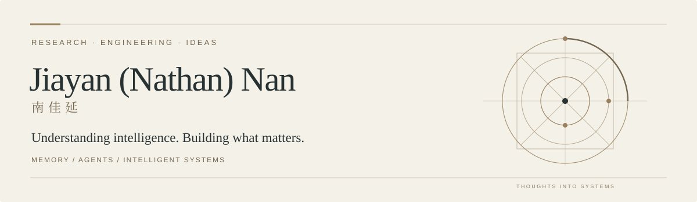

  

I'm **Jiayan (Nathan) Nan · 南佳延**, an AI engineer at **Shanda** and a graduate of **Tongji University**.

I work on **AI agents, long-term memory, and knowledge systems**. I'm interested in how agents learn from experience, and I enjoy turning research ideas into systems people can actually use.

[Research](#research) · [Open source](#open-source) · [Questions](#questions-i-keep-returning-to)

## Research

### What Deserves Memory

**Adaptive Memory Distillation for LLM Agents**  
Wenquan Ma, **Jiayan Nan**, and WenLong Wu  
*ACL 2026 · Main Conference · Long Papers*

We introduce **Nemori**, a framework that turns interactions into coherent episodes and uses prediction error to distill useful knowledge. The question behind the work: how can an agent learn what is worth remembering?

[Read the paper ↗](https://aclanthology.org/2026.acl-long.1607/) · [Explore NEMORI ↗](https://github.com/nemori-ai/nemori)

## Open source

**[MIRIX](https://github.com/Mirix-AI/MIRIX) · Contributor**  
Memory systems for AI agents. My contributions include [procedural memory and experience-to-skill distillation](https://github.com/Mirix-AI/MIRIX/pull/136), [session-aware messages](https://github.com/Mirix-AI/MIRIX/pull/126), and [OpenRouter model integrations](https://github.com/Mirix-AI/MIRIX/pull/125).

**[EverMem](https://github.com/nanxingw/EverMem)**  
Connecting AI coding assistants to persistent memory through EverMemOS.

**[AutoViral](https://github.com/nanxingw/AutoViral)**  
An AI content creation workspace, from research and ideas to finished videos.

## Questions I keep returning to

- What should an agent remember, and what should it let go?
- How can experience become reusable knowledge and skills?
- What makes an intelligent system useful beyond a compelling demo?

---

*Research, code, and thoughts still taking shape.*  
研究、代码，以及还没想清楚的问题。
